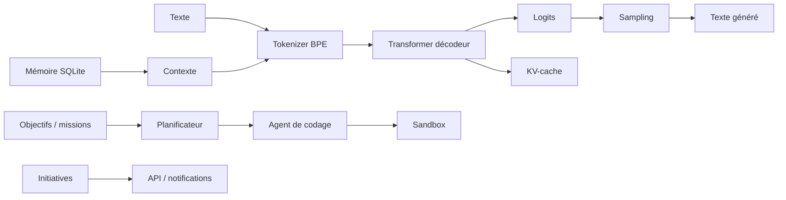
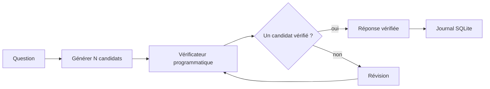

# Architecture de CORTEX-0

## Vue d'ensemble



Le dépôt sépare volontairement quatre couches :

1. **Modèle** : tenseurs, attention, génération. Aucune dépendance à l'API.
2. **Systèmes cognitifs** : mémoire, raisonnement, planification, initiative.
3. **Exécution** : file de tâches, workers, sandbox, agent de codage.
4. **Interfaces** : CLI, FastAPI, export Hugging Face.

Chaque couche est testable indépendamment. Les tests du modèle n'importent pas
l'API ; les tests de l'API peuvent injecter un petit modèle.

## Le Transformer

Le modèle reproduit la disposition de Llama pour permettre un export direct.

| Composant | Implémentation | Fichier |
| --- | --- | --- |
| Normalisation | RMSNorm pré-norm | `cortex/model/layers.py` |
| Position | RoPE, cache cos/sin | `cortex/model/layers.py` |
| Attention | causale, GQA, KV-cache | `cortex/model/attention.py` |
| MLP | SwiGLU | `cortex/model/layers.py` |
| Bloc | attention + MLP + résidus | `cortex/model/transformer.py` |
| Tête | `lm_head`, embeddings liés | `cortex/model/transformer.py` |
| Génération | température, top-k, top-p, pénalité | `cortex/model/generation.py` |

### Formes des tenseurs

Pour `B` = batch, `T` = longueur, `H` = hidden, `V` = vocabulaire,
`n_h` = têtes, `n_kv` = têtes KV, `d` = `H / n_h` :

| Tenseur | Forme |
| --- | --- |
| `input_ids` | `[B, T]` |
| `embed_tokens(input_ids)` | `[B, T, H]` |
| `q_proj` | `[B, n_h, T, d]` |
| `k_proj`, `v_proj` | `[B, n_kv, T, d]` |
| scores d'attention | `[B, n_h, T, T]` |
| `o_proj` | `[B, T, H]` |
| `mlp` | `[B, T, intermediate]` |
| `logits` | `[B, T, V]` |
| KV-cache par couche | `([B, n_kv, T_past, d], [B, n_kv, T_past, d])` |

### Attention et GQA

- Le masque causal est additif : `0` pour les positions autorisées,
  `-inf` (valeur minimale du dtype) ailleurs.
- Un masque de padding `[B, T]` peut être combiné au masque causal.
- Les têtes KV sont répétées (`repeat_kv`) pour couvrir les têtes de requête.
- Le cache est une liste de tuples `(k, v)` par couche, de longueur
  `past_len + T`.

Le test `test_kv_cache_equivalence` compare la passe complète et la passe
incrémentale token par token : écart maximal `< 1e-5`.

### RoPE

`RotaryEmbedding` précalcule `cos` et `sin` jusqu'à
`max_position_embeddings`, puis les découpe selon `position_ids`. La passe
incrémentale utilise `arange(past_len, past_len + T)`, ce qui garantit la
cohérence avec la passe complète.

### Convention de perte

`CortexForCausalLM.forward` calcule une cross-entropy **non décalée** :
`logits[t]` est comparé à `labels[t]`. Les jeux de données doivent donc fournir
des cibles déjà décalées :

- préentraînement : `y[t] = x[t+1]` ;
- SFT : `collate_sft` décale les labels d'une position vers la gauche.

Cette convention est testée (`tests/test_training.py`).

### Génération

`generate` et `generate_stream` partagent le même itérateur interne
(`_iter_tokens`). Le test `test_stream_matches_generate` vérifie que les deux
produisent exactement les mêmes tokens.

Contrôles :

- `max_new_tokens` + longueur du prompt ≤ contexte, sinon `ValueError` ;
- `eos_token_id` et tokens d'arrêt supplémentaires ;
- `pad_token_id` pour le batch ;
- température nulle = greedy déterministe.

## Tokenizer

`cortex/tokenizer/bpe.py` entraîne un BPE byte-level avec la bibliothèque Rust
`tokenizers`. L'alphabet initial contient les 256 octets : tout texte UTF-8
est représentable, sans token inconnu.

Tokens spéciaux, IDs fixes :

| ID | Token |
| --- | --- |
| 0 | `<|pad|>` |
| 1 | `<|bos|>` |
| 2 | `<|eos|>` |
| 3 | `<|unk|>` |
| 4 | `<|system|>` |
| 5 | `<|user|>` |
| 6 | `<|assistant|>` |
| 7 | `<|end|>` |
| 8 | `<|tool|>` |
| 9 | `<|observation|>` |

Template de chat :

```text
<|bos|><|system|>Tu es CORTEX-0<|end|><|user|>Bonjour<|end|><|assistant|>
```

`encode_supervised` masque les tokens système et utilisateur avec `-100` :
seuls les tokens assistant (contenu + `<|end|>`) contribuent à la loss SFT.

## Mémoire

`MemoryStore` utilise SQLite avec FTS5. Sept types :

- `working` : notes à durée de vie courte ;
- `short_term` : contexte récent ;
- `long_term` : connaissances durables ;
- `episodic` : résumés de sessions ;
- `semantic` : faits et synthèses ;
- `project` : décisions et état du projet ;
- `preference` : préférences utilisateur.

La recherche combine trois signaux : FTS5, recouvrement lexical et similarité
d'embeddings hashés. Les embeddings sont déterministes (`blake2b`) : aucun
modèle externe, aucun téléchargement.

La consolidation est extractive. Elle ne modifie jamais les poids du modèle.

## Raisonnement



Le vérificateur arithmétique évalue les expressions avec un AST restreint
(opérations autorisées, profondeur limitée, exposant limité). Il ne fait pas
appel à un autre modèle. La confiance affichée est une probabilité de softmax
moyenne sur les tokens de la réponse ; elle n'est pas une garantie.

GRPO est implémenté comme brique testée (`group_advantages`, `grpo_loss`,
`sequence_logprobs`) et utilisé par une boucle expérimentale. Aucun résultat de
raisonnement fort n'est revendiqué.

## Planification et missions

Une mission contient :

- un plan de 5 étapes (inspection, identification, implémentation, tests, git) ;
- une liste d'instructions horodatées ;
- des checkpoints (20 maximum) ;
- un statut (`active`, `paused`, `completed`, `failed`, `awaiting_approval`).

`add_instruction` remet en attente les étapes `in_progress`, conserve les
étapes `done` et ajoute une étape d'intégration. Une mission n'est jamais
rejouée depuis zéro après une nouvelle instruction.

## Initiative

Le moteur combine quatre sources :

1. objectifs bloqués (`GoalStore.stalled`) ;
2. mémoire projet récente ;
3. questions sans réponse (`memory_questions`) ;
4. recombinaison d'idées (`ideas.py`).

Chaque candidat reçoit un score. La policy filtre : activation, heures calmes,
intervalle minimum, plafond quotidien, inactivité utilisateur, nombre
d'initiatives en attente, score minimum. La déduplication compare le texte aux
initiatives récentes (similarité lexicale et embeddings).

Le scheduler persiste `last_tick` dans la table `kv`, ce qui évite de spammer
après un redémarrage.

## Exécution et agent de codage

- `TaskQueue` : file durable SQLite, priorité, `run_at`, `max_attempts`,
  `idempotency_key`, bail de visibilité (`locked_by`, `locked_at`).
- `Worker` : réclame une tâche, exécute un handler, `ack` ou `fail` avec
  retry.
- `Sandbox` : sous-processus, `cwd` confiné, liste blanche d'exécutables,
  refus des variables d'environnement sensibles, limites CPU/mémoire, timeout.
- `Workspace` : lecture/écriture/listage avec jail de chemins.
- `CodingAgent` : plan, policy d'action, approbation, exécution, journal.

Voir `docs/SECURITY.md` pour les limites exactes.

## Décisions de conception

- **Llama-compatible plutôt qu'original** : l'export Hugging Face est vérifié
  numériquement, ce qui rend les poids utilisables immédiatement.
- **Pas de dépendance à un LLM externe** : la génération, la mémoire et le
  raisonnement sont locaux.
- **Vérificateurs programmatiques** : un score de raisonnement doit être
  mesurable, pas déclaratif.
- **SQLite plutôt qu'un serveur** : reproductible, sans infrastructure, adapté
  à un projet mono-utilisateur.
- **Sandbox processus, pas conteneur** : simplicité et portabilité ; le risque
  résiduel est documenté et les actions sensibles demandent une approbation.

## Ce qui n'est pas implémenté

- MoE, attention linéaire, multi-token prediction ;
- entraînement distribué / GPU dans ce dépôt ;
- RAG sur documents PDF avec OCR ;
- exécution conteneurisée ou Kubernetes ;
- conscience, émotions ou autonomie non bornée.
