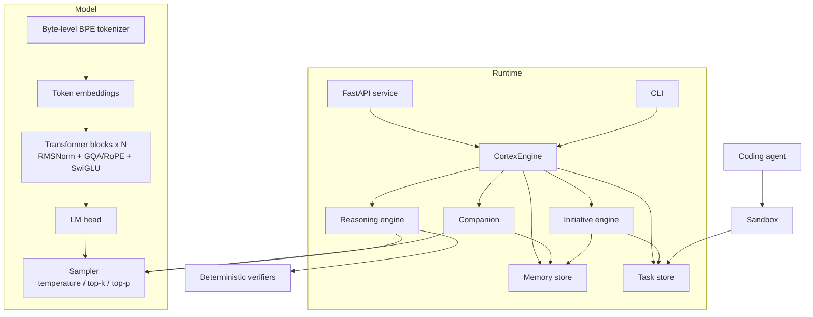

# CORTEX-0 architecture

CORTEX-0 is two things kept deliberately separate:

1. **A language model trained from scratch** (`cortex/model`, `cortex/tokenizer`, `cortex/training`).
2. **A software stack around that model** (`cortex/memory`, `cortex/reasoning`, `cortex/initiative`,
   `cortex/planning`, `cortex/coding`, `cortex/api`).

The software stack is real and testable. It does not make the model smarter than its weights allow.



## Model

| Component | Implementation |
| --- | --- |
| Tokenizer | byte-level BPE (`tokenizers`), 8,192 tokens, 6 special tokens |
| Positional encoding | RoPE, precomputed cos/sin tables |
| Normalisation | RMSNorm (pre-norm) |
| Attention | causal grouped-query attention, KV cache |
| Feed-forward | SwiGLU |
| Embeddings | tied input/output embeddings |
| Head | linear language-modeling head |

The model is decoder-only and trained with next-token prediction:

```
logits = LM(token_ids)
loss   = cross_entropy(logits[:-1], token_ids[1:])
```

Incremental generation uses a KV cache; a test asserts that cached decoding matches a full
forward pass within `1e-4`.

## Data pipeline

```
TinyStories parquet
  -> filter by length
  -> BPE training sample
  -> tokenizer.json
  -> uint16 token streams (train.bin, val.bin)
  -> meta.json (measured counts)
```

The tokenizer is trained on the corpus, not downloaded. `meta.json` records the real number of
stories, characters, tokens and characters per token.

## Memory tiers

| Tier | Storage | Purpose |
| --- | --- | --- |
| Working | in-process deque, token budget | current turn scratchpad |
| Episodic | SQLite `episodes` | conversation turns and events |
| Semantic | SQLite `facts` | stable facts, consolidated statements |
| Preferences | SQLite `preferences` | user settings, initiative frequency |
| Project | SQLite `projects` | goals and project notes |

Retrieval uses a TF-IDF-style score with a 30-day half-life, not an embedding index. This is
external memory: it changes the prompt, never the weights.

## Reasoning engine

```
problem
  -> N sampled traces (temperature)
  -> answer extraction
  -> majority vote (self-consistency)
  -> deterministic verification (arithmetic)
  -> optional reflection / revision
  -> final answer + full trace
```

The verifier evaluates arithmetic expressions with a restricted AST evaluator. It is not a
general critic and it is not used to claim general reasoning ability.

## Initiative engine

A candidate message is delivered only if all gates pass:

1. initiatives enabled
2. outside quiet hours
3. cooldown since the last message
4. daily cap not reached
5. a candidate exists
6. novelty above threshold against recent messages
7. score above threshold

Candidates come from open tasks, unresolved questions, project goals and facts. If a model is
loaded, one model-generated idea is added and filtered by the same gates. Returning `None` is the
normal outcome.

## Persistent tasks

Tasks and steps live in SQLite. Checkpoints are JSON files. `add_instruction` appends steps and
increments the revision while preserving completed work. `resume` returns the next step and the
latest checkpoint, so a different process can continue the mission.

## Coding agent

The coding agent is confined to a workspace root:

* path resolution rejects `..` escapes;
* commands run without a shell, from an executable allowlist, with a timeout and a scrubbed env;
* destructive actions (`delete`, `install`, `network`, `deploy`) require explicit approval;
* snapshots copy the workspace so a change can be reverted;
* every mission produces a JSON report.

The sandbox is a process-level guard, not a security boundary. Run untrusted code in a container
or VM.
